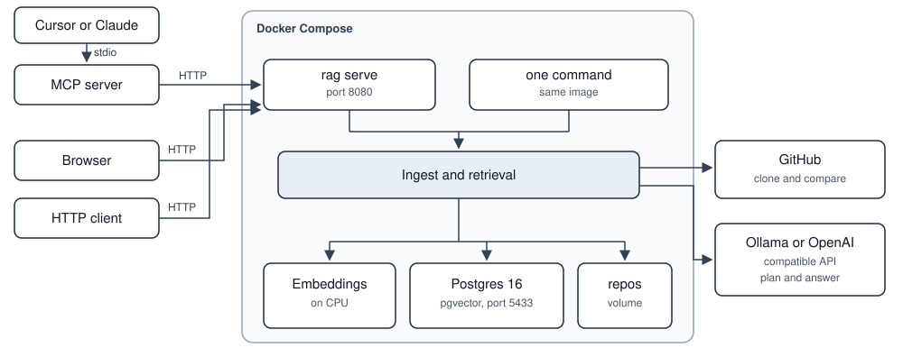

# Code RAG

A local retrieval system for GitHub repositories. Postgres stores the index. Its image is the official Postgres 16 image with the pgvector extension installed. A second container clones a repository, splits it into code chunks, and answers command-line questions from that index. Both containers are defined in Docker Compose, so the same commands work on Windows, macOS, and Linux.

The first repository to index is [hmcts/hwf-publicapp](https://github.com/hmcts/hwf-publicapp).

## Table of contents

- [Architecture](#architecture)
- [What you need](#what-you-need)
- [Start](#start)
- [Web](#web)
- [MCP](#mcp)
- [HTTP API](API.md)
- [Ask questions](#ask-questions)
- [Examples](#examples)
- [Logs](#logs)
- [Index another repository](#index-another-repository)
- [Written answers](#written-answers)
  - [Search model and answer model](#search-model-and-answer-model)
  - [Local model with Ollama](#local-model-with-ollama)
  - [Hosted model](#hosted-model)
- [How the index is built](#how-the-index-is-built)
- [Data](#data)
- [Evaluate the indexes](#evaluate-the-indexes)
- [Tests](#tests)

## Architecture

The browser and any HTTP client call the server on port 8080. The MCP server runs on the host, speaks JSON-RPC to Cursor or Claude on standard input, and calls that same server. A command such as `docker compose run` starts another container from the same image and runs one command against Postgres directly.

Ingest clones the repository from GitHub into the `repos` volume, splits it into chunks, and embeds those chunks on CPU. The vectors and the keyword index live in Postgres. A question is embedded with the same models, then matched against a vector index and the keyword index. When a language model is configured, it turns the question into a few short searches and can write the answer. That call goes to Ollama on the host or to an OpenAI-compatible API.

The database is published on port 5433. The page and the HTTP API share port 8080.



## What you need

- Docker, with Compose v2 (`docker compose`)

The app container already contains Git and both embedding models. Nothing else has to be installed on the machine.

## Start

From this directory:

```powershell
docker compose build
docker compose run --rm -T rag ingest https://github.com/hmcts/hwf-publicapp
```

The first build downloads two embedding models and takes a few minutes. `BAAI/bge-small-en-v1.5` is about 67 MB on disk. `jinaai/jina-embeddings-v2-base-code` is about 640 MB. Together that is about 700 MB of model files. The text model needs a few hundred megabytes of RAM once it is loaded. The code model is larger: with both models loaded, allow about 2 GB to 4 GB of RAM, and more while a big repository is being embedded. A query that stays on the text index does not load the code model. The ONNX runtime is started with its memory arena off, which is what keeps this inside a laptop-sized Docker machine. If the process is killed during ingest, give the container more memory and run `backfill` again. It continues from the chunks that are still missing.

The code model embeds 4 chunks at a time (`CODE_EMBED_BATCH`) and reads at most 2048 tokens of each (`CODE_EMBED_TOKENS`). A batch is padded to its longest chunk, and attention memory grows with the square of that length. With the model's own limit of 8192 tokens, four dense chunks, such as a lockfile or minified JSON, needed more than 6 GB and stopped Docker Desktop. With these limits the worst case is about 3 GB. Ruby code runs to about 3 or 4 characters a token, so 2048 tokens covers nearly all of a normal chunk. The text model embeds 32 at a time (`TEXT_EMBED_BATCH`) and stops at 512 tokens.

The first ingest clones the repository and embeds every chunk with both models on CPU. Later ingests of the same commit return immediately once both embeddings are stored. If the code embeddings are missing, that ingest fills them in place instead of copying the chunks.

Only one index is built at a time. That holds whether the ingest was started from the page, MCP, or the command line. While one is running, every open page disables **Index**, **Update the index**, and **Remove this index**, and the server turns away a second ingest. An ingest started from the command line shows on the page as "Another process is building an index".

## Web

```powershell
docker compose up -d
```

Open http://localhost:8080. Switch between Query, Impact, Search, Flow, Features, Testing, and History, choose an indexed repository, and run it. Features finds an existing Cucumber step, or the steps to reuse when writing a feature. Testing explains how to run the Cucumber suite under `features/`, a group of scenarios, or one scenario, and how to debug a scenario that is being written. The commands are quoted from that repository. RSpec and Minitest are left out. A pasted Gherkin line is matched as that line. A request to write a feature is searched as the behaviour, and the written answer quotes only steps that appear in the passages. History steps through one file on that repository's branch. Choose one repository and a path such as `app/helpers/application_helper.rb`. Leave Block blank for the whole file. A name such as `address_lookup_access_token` keeps only the commits that change that method, class, or scenario, and each step shows that block alone. The versions are read from a local git clone of the branch, including commits newer than the index, and the indexed checkout stays on the commit that was embedded. The page shows at most twelve versions. For a block it reads further back through the file and keeps the commits that change that block, still at most twelve. Step backward, Step forward, and Play move through them. Each step names the author and the time. Added lines stay green and removed lines stay struck out. The indexed commit is marked when it is one of those versions. Flow draws the main journeys it can find in the selected repository. Help with Fees comes from the application's question list or its redirects. A test suite comes from its page objects and the journey that clicks through them, which is how the Employment Tribunals claim and response are drawn. A start path such as `/steps/opening/start_or_continue` draws the journey an application chooses in its decision tree, which is how the C100 child arrangements application is drawn. Each box opens the file for that step on the indexed commit. A corner mark is a step a feature or step definition names. When the branch has newer commits, the chart lists steps added, removed, or rewired since the indexed commit. **Ask about this journey** follows an arrow when the question names a step and its answer, and otherwise searches only the files for the steps on that chart. Each passage links to those lines in the indexed commit on GitHub. **Save as HTML** downloads that result as one file. It starts with a table of contents, then the question or target, the written answer, and each passage with its file, lines, and code. An impact result includes the same relationship diagram as the page, so a file's scenarios stay in one box until you choose it. A dashed arrow is a possible call. The file stays on your machine. The app does not keep a copy. Index another GitHub repository from the same page. A first index takes several minutes and the page shows its progress.

When the page opens, it asks GitHub which commit each indexed branch is at. A repository whose branch has moved on is marked "branch has newer commits" in the list. Choose it to see both commits, and use **Update the index** to index the branch again. The app keeps GitHub's answer for ten minutes, and a branch that cannot be read is left unmarked.

`docker compose run` still runs one command, so the wrappers keep working while the web app is up.

## MCP

A Model Context Protocol server lets another language model call the running app. It speaks JSON-RPC on standard input and uses the web API, so start the app first with `docker compose up -d`. The server needs only Python on the host. It does not open the database itself. The HTTP routes are documented in [API.md](API.md). A program can call those routes itself.

```powershell
python mcp/server.py
```

Cursor loads that command from `.cursor/mcp.json` under the name `code-rag`. `CODE_RAG_URL` defaults to `http://127.0.0.1:8080`.

Claude Code, including the Claude extension for VS Code, does not read `.cursor/mcp.json`. It reads `.mcp.json` in the project root, which defines the same `code-rag` server over stdio. Open the project folder, type `/mcp` in the Claude chat, and approve `code-rag`. Until you approve it, it is listed as pending and its tools are not offered. Then ask in plain words, for example "Use code-rag to list the indexed repositories".

`.mcp.json` starts the server with `python3`, which is the name macOS and Linux use. Where the command is `python`, as on Windows, set `CODE_RAG_PYTHON` to `python` before you start VS Code or `claude`. Check what Claude Code has loaded with:

```sh
claude mcp get code-rag
```

The tools are `repositories`, `query`, `search`, `features`, `testing`, `impact`, `flow`, `default_branch`, `branches`, `ingest`, and `remove_index`. `features` matches a pasted Gherkin step, or searches a request to write a feature as the behaviour and quotes only steps already in the suite. `testing` explains how to run or debug the Cucumber suite under `features/`, and quotes only commands from that repository. `flow` returns the same journeys as the Flow button, with a GitHub URL on each step. `branches` lists a GitHub repository's branches with the default first, so the model can choose one for `ingest`. `query` returns the passages and leaves the app's own written answer off, so the calling model reads the code. Set `answer` to true when you also want that reply. `query` takes an optional `index` of `text`, `code`, or `both` (the default is `code`) and an optional `fusion` of `rrf` or `score` (the default is `rrf`; use `score` with `both`). `impact` returns the definitions, the callers, and the diagram. `FactoryBot.create(:claim)` is a valid impact target. `remove_index` deletes one index only when `confirm` is true. Passage text is shortened in the tool result. The page still shows the full chunk.

On macOS or Linux the same commands work. `rag.ps1` and `rag.sh` are thin wrappers:

```powershell
.\rag.ps1 query "where is the application submitted"
```

```sh
./rag.sh query "where is the application submitted"
```

## Ask questions

```powershell
docker compose run --rm -T rag query "where is the application submitted"
docker compose run --rm -T rag query "how are fees calculated" -k 12
docker compose run --rm -T rag query "how are fees calculated" --index code
docker compose run --rm -T rag query "how are fees calculated" --index both --fusion score
docker compose run --rm -T rag impact "OnlineApplication"
docker compose run --rm -T rag repos
```

`query` retrieves the code passages most relevant to a question. `--index code` (the default) searches the code-model embeddings. `--index text` searches the general-English embeddings. `--index both` merges those two ranked lists with reciprocal rank fusion; pair it with `--fusion score`. The page has the same selector. A question that asks what calls a class or method, or what is affected by changing one, is answered with Impact instead of the vector indexes. A question that names a directory and a value, such as `look under /app for 4250 or min_threshold_base`, searches that directory for those values and leaves the rest of the repository out. It does not use either vector index. `Ignore files in folders /features/support and /features/step_definitions` leaves those folders out, including a step definition or page object reached from a feature file. Quote the text to match it exactly: `look under /features for "with income '8000' and average"` finds that step and leaves other income files out. Inside the quotes, a regular expression is used as written. `look under /features for "with income '[0-9]*' and average"` matches any amount in that step. Use `[0-9]` for a digit. When the quoted text is not in the index, the result is empty. The page shows when this process started. When more matches exist than the Passages limit, the page says so. A question that asks to show or list features returns feature files only. When a question names a `.feature` file and asks how that step runs, retrieval follows it into its step definition and the page-object methods that fill fields and click buttons. `impact` looks up a class, method, or file and groups the result into definitions, references, and related code. References include specs and feature tests when those files mention the name.

Search covers every indexed repository. Each repository is searched on its own, then the passages are sorted by how close they are to the question, so a weaker match sinks below a closer one. Pass `--repo hmcts/hwf-publicapp` when more than one is loaded and you want only one.

## Examples

Paste a query into Query on the page, or pass the same text to `query`. Paste an impact target into Impact, or pass it to `impact`. Paste a Gherkin step, or a feature to write, into Features, or pass it to `features`. Ask Testing, or `testing`, how to run or debug the Cucumber suite. On History, choose one repository and a file path. Leave Block blank, or name a method, class, or scenario. History is on the page only. These are written for [hmcts/hwf-publicapp](https://github.com/hmcts/hwf-publicapp), except the claim factory, which is run against [hmcts/et-full-system](https://github.com/hmcts/et-full-system). On the command line, add `--repo hmcts/hwf-publicapp` when both Help with Fees repositories are indexed and the request should stay in one of them.

### Queries

```text
where is the application submitted
```

An ordinary question. The passages are the closest code, sorted by that closeness.

```text
look for limit
```

A semantic question. A passage about a threshold can rank above one that only contains the word limit. With both repositories indexed, this also reaches the staff app.

```text
look under /app for 4250 or min_threshold_base
```

The named directory is the only place searched, and the search is for those values.

```text
look under /features for birth date. Ignore files in folders /features/support and /features/step_definitions
```

Date-of-birth scenarios under `features`. The ignored folders stay out of the result.

```text
look under /features for "with income '8000' and average"
```

The quoted words have to appear. Other income files stay out.

```text
look under /features for "with income '[0-9]*' and average"
```

Inside the quotes this is a regular expression. `[0-9]*` matches any amount. The page says when more matches exist than the Passages limit.

```text
which features cover date of birth
```

A request to list features returns feature files only.

```text
how does features/dob/dob_single.feature enter the date of birth
```

Naming a feature file and asking how it runs follows one step into its step definition and the page-object method. For this file that step is `I enter a valid date of birth`, which calls `DobPage#valid_dob`.

### Impact

```text
ApplicationController#online_application
```

The qualified name selects that method. The result is grouped into definitions, references, and related passages. The page draws the call paths, with each arrow pointing from a caller toward the definition. When the diagram has more than 12 boxes, three or more callers in the same file are drawn as one box, such as a feature file and its count of scenarios. Choose that box to list them, or use **Expand all**.

A call written as a bare name, such as `fill_in_all`, has no receiver. It is found anywhere in a line of Ruby, so `total = fee_amount` and `expect(fee_amount).to eq(5)` both count as calls to `fee_amount`. A name the code assigns, takes as a parameter, or declares with `let` is a local value and is not counted.

A bare name is linked only to a method Ruby could reach that way:

- a method of the caller's own class, or of a class it inherits from
- a method of a module, when the caller is not in a class or its class file names that module
- a method defined outside any class or module

A method of an unrelated class is never linked. A method defined in a spec file is linked only inside that file, and application code is never linked to a method under `spec`, `features`, or `test`. Names that Capybara, RSpec, and Rails define, such as `page` and `params`, are linked only inside the class that declares its own.

When one method fits, the call is certain. When two to five fit, each is a possible target. That caller is listed with `⇢` in its path, and the diagram draws that arrow dashed. A name with more matches is left as a plain reference.

```text
factory :online_application
```

Specs that call `build` or `create` for that factory. A trait passed as a symbol is its own passage, for example `factory :online_application trait :savings_more_than_threshold`. `build`, `create`, `build_list`, and `create_list` are the same reference to the factory.

```text
IncomePeriodPage#submit_income
```

The page method, the step definition that calls `income_period_page.submit_income`, and the feature scenarios that match that step. Each of those passages shows the path back to the method. Features and the page are listed before specs.

```text
NullifyBlank
```

The concern is listed, and its `define_method` and `public_send` calls appear under Unresolved. Those calls have no guessed target.

```text
FactoryBot.create(:claim)
```

Run this against `hmcts/et-full-system`. On the page, choose that repository before Impact. On the command line:

```powershell
docker compose run --rm -T rag impact "FactoryBot.create(:claim)" --repo hmcts/et-full-system
```

The factory `factory :claim` is listed under Definitions. Specs that build or create a claim are references, including `build(:claim)` and `create_list(:claim, …)`. Each reference shows the path back to the factory.

### Features

Features skips the question planner. A pasted Gherkin line is matched under `features/` on the step text, then followed into the step definition. Files under `features/` are listed before other directories. Given, When, Then, And, and But are the same step, so a second Then, Given, or When written as And still matches. A request to write a feature drops the instruction to write one and searches the behaviour that remains. The written answer quotes only steps that appear in the passages. A check with no such step is named and left unwritten.

```text
Then I should see this date can't be in the future error message
```

`And I should see this date can't be in the future error message` finds the same passages. They are `features/fee.feature` (scenario “Date is in the future”), the same step in the probate features, and `features/step_definitions/fee_steps.rb`.

```text
Write a Cucumber feature for an applicant who already paid the fee and wants a refund. The payment date cannot be in the future or more than three months ago. Reuse existing step phrasing.
```

The search that runs is “an applicant who already paid the fee and wants a refund. The payment date cannot be in the future or more than three months ago.” `features/fee.feature` is in the passages, including the scenarios “Date exceeding 3 months” and “Date within the last 3 months”. The written answer quotes those steps. It also says the suite has no Gherkin line for the refund request itself.

On the command line:

```powershell
docker compose run --rm -T rag features "Then I should see this date can't be in the future error message" --repo hmcts/hwf-publicapp
```

### Testing

Testing skips the question planner. It looks up the commands the repository documents for Cucumber under `features/`, including `cucumber.yml`, and leaves `spec/` and `test/` out. The written answer quotes those commands. It covers the suite, a group (a directory, a tag, or a profile), one scenario, and how to debug a scenario that is being written. A command that is not in the passages is not invented, so a `file:line` form is given only when the repository shows it.

```text
How do I run the Cucumber suite, features/fee.feature, and one scenario, and how do I debug a scenario I am writing?
```

On `hmcts/hwf-publicapp`, `features/README.md` shows `bundle exec cucumber features` for the suite, a feature file, and a line number for one scenario. The root README also shows `CAPYBARA_SERVER_PORT=random bundle exec rake parallel:features`. `config/cucumber.yml` includes the `wip` profile, and the features README sets `DRIVER` when a browser should be visible. On `ministryofjustice/c100-application` the README shows `bundle exec cucumber features`, `bundle exec cucumber features/miam.feature`, a tag with `-t @happy_path`, and `SHOW_BROWSER=1` when the browser should be visible while debugging.

On the command line:

```powershell
docker compose run --rm -T rag testing "How do I run the Cucumber suite, features/fee.feature, and one scenario, and how do I debug a scenario I am writing?" --repo hmcts/hwf-publicapp
```

### History

Choose one indexed repository, then a path in that repository. The file is read from a separate clone of the branch, so the indexed checkout stays on the commit that was embedded. A private repository uses the same `GITHUB_TOKEN` as ingest.

```text
app/helpers/application_helper.rb
```

With Block left blank, the page steps through the twelve most recent commits that touch the file, from the oldest of that window. On `hmcts/hwf-publicapp` that run of `app/helpers/application_helper.rb` starts with the Welsh copy change in March 2017. Added lines stay green, with a `+` in the gutter. Removed lines stay on a red background and struck out. The rest of the file is dimmed, and the view scrolls to the first changed line. **Open this commit** opens that version on GitHub.

```text
address_lookup_access_token
```

The same path with that block name shows `ApplicationHelper#address_lookup_access_token` and nothing else in the file. The only commit that changes it is `RST-3163 address lookup`, which adds the method at line 14. Later edits to the rest of the helper are left out. A name that matches more than one declaration has to be the full symbol, such as `ApplicationHelper#address_lookup_access_token`. The block follows a method, class, or scenario in Ruby, Python, JavaScript, TypeScript, Java, or Gherkin.

## Logs

A query, a search, and an impact lookup write a trace to the process output. Times are UTC. The API key is not written. For the web app:

```powershell
docker compose logs rag
```

`docker compose run` prints the same lines in the command output.

One `retrieval` line records the question and how it was searched. `path` is `semantic` for an ordinary question, or `values`, `text`, or `regular expression` when the question was matched directly. `k` is the Passages limit. `repos` lists the repositories that were searched. `scopes` and `excluded` are the directories kept and left out. `truncated` is `true` when more matches existed than `k`. `queries` are the searches that ran, and `dropped` appears when a planned search was left out because it only repeated a directory. Each `hit` line is one passage that was shown: its score, repository, path, lines, symbol, and the first line of the chunk. A higher score is a closer match.

```text
2026-11-07 12:23:09 INFO retrieval path=semantic k=2 repos=hmcts/hwf-publicapp|hmcts/hwf-staffapp scopes=- excluded=- truncated=true passages=2 queries=look for limit. question='look for limit.'
2026-11-07 12:23:09 INFO hit 0.6997 hmcts/hwf-staffapp app/models/query/last_updated_applications.rb:7-12 Query::LastUpdatedApplications#find | def find(limit: nil)
2026-11-07 12:23:09 INFO hit 0.6739 hmcts/hwf-publicapp spec/models/views/summary_spec.rb:113-120 Views::Summary / #savings / when the maximum threshold has been exceeded | context 'when the maximum threshold has been exceeded' do
```

An `impact` line records the name and how many definitions, references, and related passages were found. A warning is written when a request is rejected, planning fails and the question is searched as written, the answer model fails, or an ingest fails.

## Index another repository

```powershell
docker compose run --rm -T rag ingest https://github.com/owner/name
docker compose run --rm -T rag ingest owner/name --branch main
docker compose run --rm -T rag ingest owner/name --force
docker compose run --rm -T rag remove owner/name
```

`--force` rebuilds the index even when that commit is already stored. Use it after the chunking code changes. `remove` deletes that repository's index and its checkout. The other repositories stay. On the page, choose the repository and use Remove this index. Index it again to store a different branch.

For a private repository, set `GITHUB_TOKEN` in a `.env` file next to `docker-compose.yml`. Compose reads that file when it creates the container, so see [After you change `.env`](#after-you-change-env) when you edit it. `.env.example` shows the variables. Do not commit `.env`.

## Written answers

Retrieval works with no language model. The commands print the matching source.

The answer is written only from the retrieved passages, and it cites file paths and line numbers. The page shows the answer's Markdown as headings, lists, bold text, and code. `--no-answer` prints the passages and skips the model. `--model` selects a different answer model for one command.

### Search model and answer model

A question is not sent to the index as one sentence. A small model first turns it into a few short searches, in the same way CorpRAG rewrites a question before retrieval. Each search runs on its own, and the passages are pooled. The answer model then reads those passages and writes the reply. The repository itself is still split on declarations: a method or a scenario stays in one chunk.

Questions that ask for a list of features, or that name a `.feature` file, skip this step and use the question as written.

Each response reports the elapsed time and the language-model tokens for planning the question, embedding the searches, searching the index, and writing the answer. Embedding runs locally, so that stage has a time and no token count. The total is the sum of those stages.

With Ollama, `OLLAMA_RETRIEVAL_MODEL` plans the searches and `OLLAMA_MODEL` writes the answer. With a hosted API, `OPENAI_RETRIEVAL_MODEL` plans the searches and `OPENAI_MODEL` writes the answer. Leave the retrieval model on the small one.

### Local model with Ollama

On the machine that runs Docker, start Ollama so it is listening on port 11434. The app container calls it through `host.docker.internal`, which works on Docker Desktop and on Linux Compose.

Use `qwen2.5-coder:7b` to plan the searches and `qwen2.5-coder:32b-instruct-q5_K_M` to write the answer. The 32b model is an instruct coder, so it stays with the retrieved Ruby and cites the passages. `gemma4:latest` is the small E4B model: quick on a laptop, and a lighter reader of a Rails application than either Qwen coder. `deepseek-r1:32b` spends the request on a reasoning trace; the retrieval has already found the passages, so that wait rarely improves the citation.

In `.env`:

```
LLM_PROVIDER=ollama
OLLAMA_RETRIEVAL_MODEL=qwen2.5-coder:7b
OLLAMA_MODEL=qwen2.5-coder:32b-instruct-q5_K_M
OLLAMA_NUM_CTX=8192
```

`OLLAMA_NUM_CTX` is the context the request actually uses. Ollama's own default is a few thousand tokens, which cuts off the retrieved code. `8192` fits a 32B model on a 32 GB Mac. Raise it to `16384` when the machine still has memory after the model loads. The first reply after a cold start can take several minutes; `OLLAMA_TIMEOUT` defaults to 600 seconds.

```powershell
docker compose run --rm -T rag query "where is the application submitted"
docker compose run --rm -T rag impact "OnlineApplication" --model qwen2.5-coder:7b
```

### Hosted model

```
LLM_PROVIDER=openai
OPENAI_API_KEY=...
OPENAI_BASE_URL=https://api.openai.com/v1
OPENAI_RETRIEVAL_MODEL=gpt-4o-mini
OPENAI_MODEL=gpt-4o
```

`OPENAI_BASE_URL` can point at any OpenAI-compatible chat API.

### After you change `.env`

Compose copies the values in `.env` into the container when it creates the container. `docker compose restart rag` restarts the same container, so it keeps the old values. After you edit `.env`, run:

```powershell
docker compose up -d rag
```

Compose sees that the settings differ and creates the container again. The index is in a volume, so it stays. The page header shows the provider and model the app is using, so check it there. Use `docker compose restart rag` only to reload changed Python code. Do not use `docker compose down -v` for either job, because it deletes the index.

## How the index is built

Each source file is split on declarations (`class`, `module`, `def`, Java methods, Cucumber scenarios). Ruby files also split on the declarations these repositories are built from: an RSpec `describe`, `context`, or quoted `it`; a SitePrism `section`; and a FactoryBot `factory` or `trait`. A chunk keeps the qualified name, for example `Application#submit`, `IncomePeriodPage section :content`, or `factory :online_application trait :savings_more_than_threshold`. Files without declarations are split into overlapping windows.

A page object, factory, spec, feature, or step definition is labelled with that role on the text that is embedded and on the keyword text. A question about a SitePrism page or a FactoryBot trait can then line up with that file. An index built before this split keeps the old chunks until you ingest that repository again with `--force`.

Those chunks are embedded locally, twice, and stored in Postgres with [pgvector](https://github.com/pgvector/pgvector). No model API is required.

- `embedding_code` is `jinaai/jina-embeddings-v2-base-code`, 768 dimensions, with the HNSW index `chunks_embedding_code_idx`. FastEmbed loads it, so there is no second embedding library. The file is about 640 MB. This is the index a query uses unless you ask for another one. FastEmbed describes it as a multilingual model covering English and about 30 programming languages, with an 8192-token input. Plan for about 2 GB to 4 GB of RAM while it is loaded next to the text model.
- `embedding_text` is `BAAI/bge-small-en-v1.5`, 384 dimensions, with the HNSW index `chunks_embedding_text_idx`. The file is about 67 MB. It is small enough to run on a laptop-sized Docker virtual machine.

Keyword search uses the Postgres `simple` dictionary, which does not stem tokens, after CamelCase and snake_case have been split. A question uses a vector index and the keyword search together.

`--fusion rrf` is the default. It uses reciprocal rank fusion (k = 60, set with `RRF_K` or `--rrf-k`). A chunk scores `1 / (k + rank)` in each list, and those contributions are added. The lists then have an equal vote, which is what you want when an exact word should compete with a semantically close passage. On a trial question, "where is the local embedding model loaded", the raw-score sum put `app/rag/embedder.py` first. Reciprocal rank fusion put the README first, because the README repeats those words and the fusion treats that keyword rank as equal to the vector rank. The eval in `eval/FINDINGS.md` preferred `code` with `rrf` overall.

`--fusion score` adds cosine similarity to `ts_rank_cd`, and a chunk missing from one list scores 0 on that side. Cosine similarity is usually much larger than `ts_rank_cd`, so the vector ranking leads and the keyword rank nudges it.

With `--index both`, the two vector lists are always merged with reciprocal rank fusion. `--fusion score` then adds the keyword score (`ts_rank_cd`) to that fused score, and is the better pairing when both indexes are used. `--fusion rrf` puts the keyword list into the same fusion as the two vector lists, so the keyword list is outvoted.

The vector scan ranks by exact cosine similarity. It turns the HNSW index scan off for that query, because the index can walk a cluster of short feature titles and miss a closer scenario. The HNSW indexes are still built, one per column.

`impact` starts with an identifier search, then walks the calls stored for those passages. A direct call, a FactoryBot `build` or `create`, a SitePrism element used on its page, an `alias`, and a Cucumber step that matches a step definition are followed for a few hops. The path is shown on the passage. `send`, `public_send`, `define_method`, and `method_missing` are listed as unresolved and are not given a guessed target. Features, page objects, and controllers are listed before specs. A qualified name such as `ApplicationController#online_application` matches that method, not every file whose name is only the method's last word. A declaration the splitter misses can be absent. The matching source is what the command shows. Call edges are built from the chunks already stored, including an index built before this walk.

Vendor directories, lockfiles, `node_modules`, VCR cassettes, and secret-shaped files (`.env`, private keys, `credentials.yml.enc`) are not indexed. `.env.example` files are.

### An index that already exists

A volume created before the two columns existed has a single `embedding` column. On startup the app renames it. A 384-dimension column becomes `embedding_text`. A 768-dimension column, from a volume that was built with the code model alone, becomes `embedding_code`. It then adds the missing column and builds the HNSW index for each column. Running that migration again does not rename anything a second time.

The renamed rows do not yet have the other embedding. Fill them without copying chunks:

```powershell
docker compose run --rm -T rag backfill
docker compose run --rm -T rag backfill hmcts/hwf-publicapp
```

`backfill` updates the null column in place. A second run finds nothing to do. Ingesting a commit that is already stored does the same fill, and leaves the chunks where they are. `--force` still rebuilds the chunks, and writes both embeddings as it goes. Do not use `docker compose down -v` for this. That deletes the index.

## Data

Postgres listens on `localhost:5433` (user `rag`, password `rag`, database `rag`). That account is for this local index.

`docker compose down` stops the containers and keeps the index. `docker compose down -v` deletes it. Checkouts live in the `repos` volume, separate from the Postgres volume.

Both models are fixed when the database is first created. Changing `EMBEDDING_MODEL` or `CODE_EMBEDDING_MODEL` means removing the volume and ingesting again. Adding the code column to an existing volume does not: use `backfill`, described above.

## Evaluate the indexes

`eval/questions.jsonl` holds a few example questions for an ingest of this repository. Each line names the file paths a good hit would land on. They are examples to replace with paths from your own ingest before you treat the numbers as a result. Chunk ids are accepted as well, but paths survive a rebuild and chunk ids do not.

The script searches once per question, without the question-planning model, and prints recall@k and mean reciprocal rank for `text`, `code`, and `both`, each with `rrf` and `score`:

```powershell
python eval/run_eval.py
python eval/run_eval.py --k 8 --repo pyardley/RAG_GitHub_Public --details
```

Run that from this directory, with Postgres listening on `localhost:5433`. Recall@k is the share of the expected paths (and chunk ids) that appear in the top k. Mean reciprocal rank uses the first hit that matches any expected path or chunk id.

`eval/hwf-publicapp.jsonl`, `eval/et-full-system.jsonl`, and `eval/c100-application.jsonl` hold 25 questions each for those repositories, and `eval/hwf-staffapp.jsonl` holds 20. Each question has a `category`, and the script prints one table per category after the overall table:

- `concept` asks in plain English and names no code, such as how long an unfinished application is kept.
- `identifier` names a method, class, or constant, or quotes a line of Ruby with no names in it.
- `impact` asks what calls a named method or class. The expected paths are the callers, not the definition.
- `step` is a Gherkin step copied from a feature file. The expected path is the step definition file.

The **Impact** button does not use either vector index for its definitions and callers. Those come from symbol matching and the call edges. Only its **Related** list runs a search, on the text index. The `impact` questions measure how well a search finds callers.

The host Python does not have the embedding models, so run these in the app image. The index for that repository has to be complete, or the expected files are not there to find:

```powershell
docker compose run --rm --no-deps --entrypoint python -v "${PWD}/eval:/eval" rag /eval/run_eval.py --questions /eval/c100-application.jsonl --repo ministryofjustice/c100-application --details
```

## Tests

The unit tests cover chunking, file selection, reciprocal rank fusion, the index and fusion options, file history, and the schema migration. They do not need Docker. When the local index is running, one test also checks that a search for `limit` still returns a passage about a threshold, and skips that check when the index is stopped:

```powershell
python -m unittest discover -s tests -v
```

Run that from this directory.

GitHub Actions runs the same tests on every push and pull request, using Python 3.12 (see `.github/workflows/tests.yml`). There is no index there, so the `limit` check skips.
